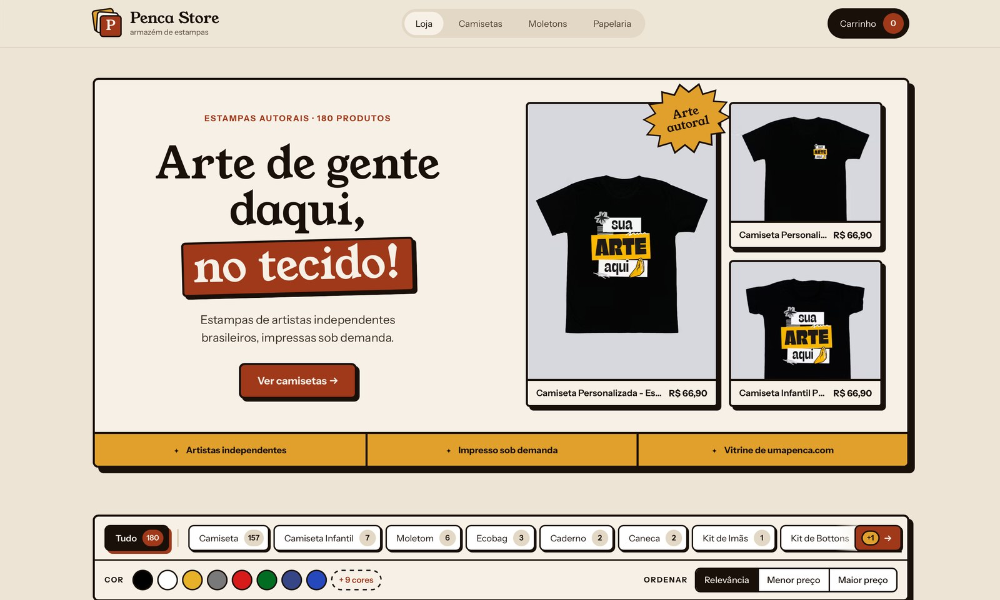
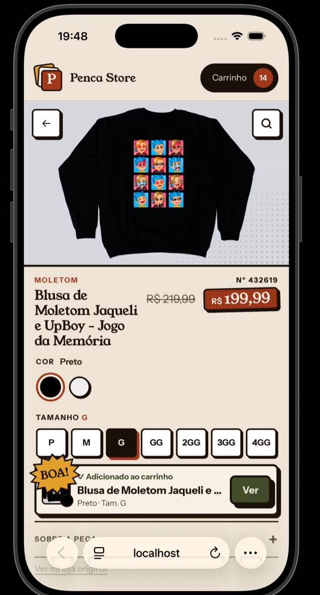
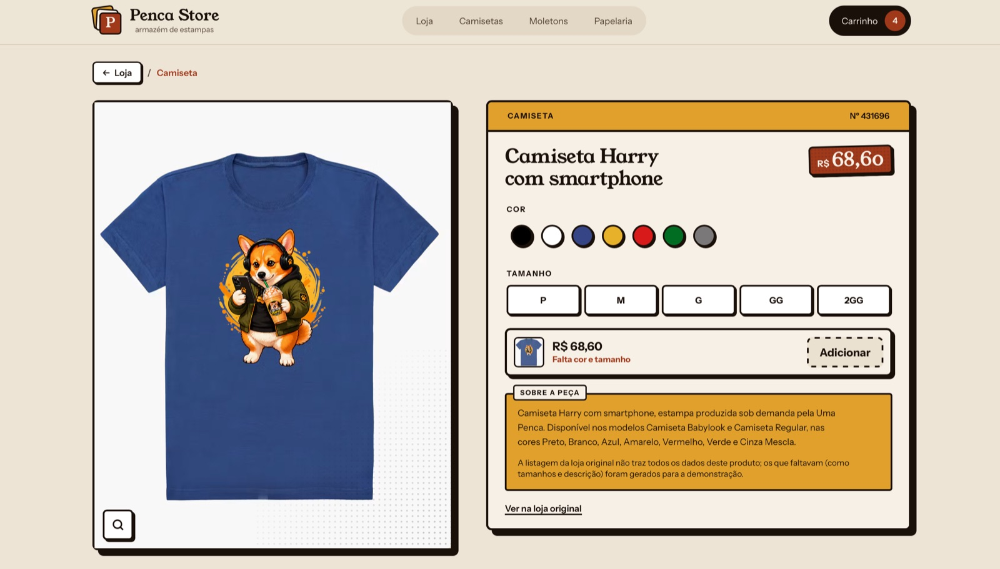
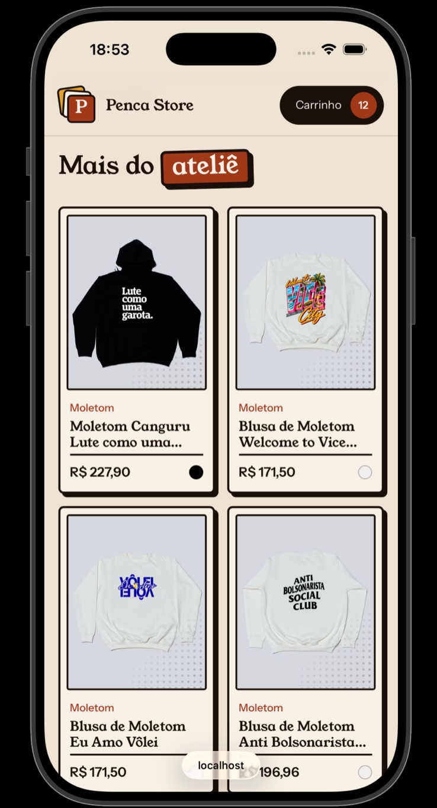
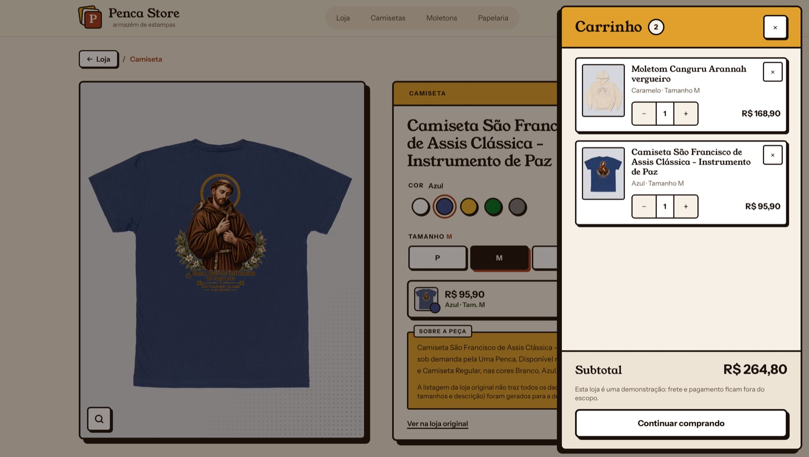

# Penca Store

Mini loja virtual em **Vue 2.7** feita para o teste técnico de front-end da Chico Rei / Uma Penca: listagem com filtros combináveis, página de produto e carrinho lateral, com os produtos coletados de [umapenca.com/loja](https://umapenca.com/loja/) e servidos por uma API própria.

**Deploy:** https://chicoreistore.vercel.app · **Repositório:** https://github.com/rayancmorais/chico_rei_store

**Design system:** [Figma](https://www.figma.com/design/CN9BQ9cNCII6SXCTjIckSK/Penca-Store-%C2%B7-Design-System?node-id=1-4)

<p align="center">
  
  
</p>
<p align="center">
  
  
</p>
<p align="center">
  
</p>

> Penca Store é um projeto de estudo, sem vínculo oficial com a Chico Rei ou a Uma Penca. As páginas têm `noindex` e o rodapé deixa isso claro para quem visita.

## Sumário

1. [Visão geral e stack](#1-visão-geral-e-stack)
2. [Como instalar, rodar e fazer o build](#2-como-instalar-rodar-e-fazer-o-build)
3. [Scraping e fluxo dos dados](#3-scraping-e-fluxo-dos-dados)
4. [Variáveis de ambiente](#4-variáveis-de-ambiente)
5. [Decisões técnicas e trade-offs](#5-decisões-técnicas-e-trade-offs)
6. [O que ficou de fora e o que eu faria com mais tempo](#6-o-que-ficou-de-fora-e-o-que-eu-faria-com-mais-tempo)
7. [Premissas assumidas](#7-premissas-assumidas)

## 1. Visão geral e stack

O que dá para fazer na loja:

- **Listagem:** grade com imagem, nome, preço e cores; filtros por tipo e por cor que se combinam; ordenação por preço; paginação. Os filtros ficam na URL, então dá para compartilhar ou recarregar uma busca filtrada. Tem estados de carregamento (skeleton), de lista vazia e de erro com "tentar de novo".
- **Produto:** rota própria (`/produto/:id`) que funciona por link direto e ao recarregar; foto do produto na cor escolhida; seleção de cor e tamanho. O botão de adicionar fica bloqueado até as escolhas serem feitas e, se clicado, mostra o que falta e leva o foco até lá.
- **Carrinho lateral:** abre a partir de qualquer tela; cada combinação de cor e tamanho é um item separado; altera quantidade, remove item e atualiza o subtotal na hora. O carrinho fica salvo no navegador e sincronizado entre abas.

| Camada                                   | Tecnologias                                                                                                     |
| ---------------------------------------- | --------------------------------------------------------------------------------------------------------------- |
| Runtime                                  | Node.js 24 (`.nvmrc`), npm workspaces                                                                           |
| Front-end (`apps/web`)                   | Vue 2.7.16 (`<script setup>` + TypeScript), Vue Router 3.6, Pinia 2.3, `fetch` nativo, Tailwind CSS 3.4, Vite 5 |
| API (`apps/api`)                         | Express 5, Helmet 8, Zod 4, tsup (bundle para a Vercel)                                                         |
| Scraper (`apps/scraper`)                 | `fetch` nativo do Node, Zod 4, tsx                                                                              |
| Tipos compartilhados (`packages/shared`) | Schemas Zod e tipos usados pela API, pelo scraper e (só os tipos) pelo front                                    |
| Testes                                   | Vitest 2, Vue Test Utils 1, MSW 2, Supertest, jsdom                                                             |
| Qualidade                                | TypeScript 5.9, ESLint 9, Prettier 3, Husky + lint-staged, commitlint (Conventional Commits)                    |
| Deploy                                   | Vercel (front estático + API como função serverless, no mesmo projeto)                                          |

Estrutura do monorepo:

```
apps/
  scraper/   coleta a vitrine e grava data/seed.json
  api/       lê o seed, enriquece os produtos e serve /api/*
  web/       a loja em Vue 2.7
packages/
  shared/    schemas e tipos compartilhados
data/
  seed.json  resultado da coleta (versionado)
api/
  index.js   ponto de entrada da função serverless na Vercel
```

## 2. Como instalar, rodar e fazer o build

**Pré-requisitos:** Node.js 24 (com `nvm`, basta rodar `nvm use` na raiz) e npm 10 ou mais novo.

```bash
git clone https://github.com/rayancmorais/chico_rei_store.git
cd chico_rei_store
npm ci
```

O npm 11 (que vem com as versões recentes do Node 24) pode avisar que bloqueou scripts de instalação de algumas dependências (esbuild, vue-demi). Pode ignorar: o projeto não depende desses scripts.

O `.env` é opcional: sem ele, todos os valores padrão funcionam. Para ajustar algo, copie o exemplo:

```bash
cp .env.example .env
```

### Desenvolvimento

```bash
npm run dev
```

Sobe a API em http://localhost:3333 e a loja em **http://localhost:5173**. O Vite repassa as chamadas `/api` para a API, então não é preciso configurar CORS.

Para ver os estados de carregamento e de erro:

- **Carregamento:** `SIMULATE_LATENCY_MS=1500` no `.env` atrasa todas as respostas da API, e o skeleton fica visível.
- **Erro na loja:** rode só o front, sem a API (`npm run dev -w @chico_rei_store/web`), e abra http://localhost:5173. Outra forma: com a loja aberta, ative o modo **Offline** na aba Network do DevTools e troque um filtro. Nos dois casos aparece a mensagem de erro com "Tentar de novo", que volta a funcionar quando a API ou a rede voltam.
- **Erro direto na API:** `?__fail=1` em qualquer rota força um erro 500, por exemplo http://localhost:3333/api/products?__fail=1. A loja não envia esse parâmetro; ele serve para testar a API isoladamente.

A simulação (`SIMULATE_LATENCY_MS` e `?__fail=1`) só existe no `npm run dev`: o `npm run start` e o deploy na Vercel sobem a API sem ela.

### Build e versão de produção local

```bash
npm run build                               # API (tsup) e front (Vite)
npm run start -w @chico_rei_store/api       # terminal 1: API compilada na porta 3333
npm run preview -w @chico_rei_store/web     # terminal 2: front compilado em http://localhost:4173
```

### Qualidade e testes

```bash
npm test             # 240 testes unitários e de componentes (API 44, scraper 30, web 166)
npm run typecheck    # TypeScript em todos os pacotes, incluindo os .vue (vue-tsc)
npm run lint         # ESLint
```

Para rodar só os testes de um app: `npx vitest run apps/web` (ou `apps/api`, `apps/scraper`).

### Recoletar os produtos (opcional)

O `data/seed.json` já vem no repositório, então a loja funciona sem rodar o scraper. Para atualizar os dados:

```bash
npm run scrape
```

## 3. Scraping e fluxo dos dados

```
umapenca.com/loja ──(scraper)──▶ data/seed.json ──(API: valida + enriquece)──▶ /api/* ──(HTTP)──▶ loja Vue
```

### Coleta (`apps/scraper`)

- A vitrine da Uma Penca entrega os produtos num JSON embutido no HTML (`window.vueInitialData`). O scraper lê esse JSON em vez de navegar pelo HTML com seletores CSS, porque o JSON muda menos que o layout e já traz cores, tipo, preço e imagem estruturados.
- O JSON é extraído contando chaves (ignorando chaves dentro de strings), já que o mesmo `<script>` tem outro código depois dele, e é validado com Zod. Se a fonte mudar de formato, a coleta falha com uma mensagem clara, em vez de gravar dados quebrados.
- **Limites:** no máximo 5 páginas, só de listagem (a página de cada produto não é aberta), e 5 s entre requisições. O enunciado pede pelo menos 1 s, mas o `robots.txt` da Uma Penca pede `Crawl-delay: 5`, e a coleta segue o mais restritivo. O `.env` pode reduzir as páginas ou aumentar o intervalo, mas nunca passar desses limites. As páginas são pedidas em sequência, com timeout de 10 s, até 2 novas tentativas com espera crescente em falhas de rede, 429 ou 5xx, e um User-Agent que identifica o projeto.
- A coleta para no limite de 5 páginas, ou antes, se chegar à última página da vitrine ou a uma página vazia. Na coleta atual (11/10/2026, com 5 s entre requisições), a vitrine tinha 278 páginas e a coleta parou no limite: 5 páginas, 180 produtos de 9 tipos.
- Os preços são convertidos para centavos inteiros (para evitar erro de ponto flutuante), as cores repetidas entre tecidos são unificadas e um produto que aparece em duas páginas é gravado uma vez só.
- **Fotos por cor:** o JSON traz uma foto da peça para cada tecido e modelo (`images_by_fabric`). O scraper guarda, para cada cor, a do mesmo modelo da foto de capa, para a peça manter o enquadramento ao trocar de cor, e ignora as amostras de tecido. Na coleta atual, 166 dos 180 produtos têm foto em todas as cores; nas cores sem foto, a página mostra a capa.
- **Nunca há scraping em tempo real:** a loja só fala com a API, e a API só lê o arquivo de seed.

### API (`apps/api`)

Na subida, a API valida o seed com o mesmo schema do scraper. Se o arquivo estiver inválido, ela não sobe. Depois, passa cada produto pelo adapter, que preenche o que a fonte não traz, e mantém tudo em memória.

| Endpoint                                            | O que devolve                                                                                                                                                                    |
| --------------------------------------------------- | -------------------------------------------------------------------------------------------------------------------------------------------------------------------------------- |
| `GET /api/products?type=&color=&sort=&page=&limit=` | Lista paginada (`data` + `meta`). `type` e `color` aceitam vários valores separados por vírgula. `sort`: `relevance`, `price_asc` ou `price_desc`. `limit` padrão 24, máximo 60. |
| `GET /api/filters?type=&color=`                     | Tipos e cores com contagem de produtos                                                                                                                                           |
| `GET /api/products/:id`                             | Produto completo (com tamanhos e descrição), ou 404                                                                                                                              |
| `GET /api/health`                                   | Status e quantidade de produtos                                                                                                                                                  |

**Regra dos filtros:** dentro de uma mesma dimensão vale "ou" (camiseta **ou** moletom); entre dimensões vale "e" (camiseta **e** preto). A contagem de cada opção considera os filtros da _outra_ dimensão. Assim, o número ao lado de "Preto" é quantos produtos a pessoa veria se marcasse "Preto" agora, e opções que dariam zero aparecem desabilitadas, em vez de levarem a uma lista vazia.

As query strings são validadas com Zod e os erros seguem um formato único (`{ error: { code, message } }`).

### Regra de enriquecimento (dados ausentes no scraping)

A listagem da Uma Penca **não informa tamanhos nem descrição**. O adapter da API gera os dois de forma **determinística**, ou seja, o mesmo produto recebe sempre o mesmo resultado, em qualquer máquina e a cada reinício:

- **Tamanhos**
  - Produtos que não são roupa (caneca, ecobag, caderno, pôster, ímã e botton): sem tamanho. O seletor não aparece e o carrinho só exige a cor.
  - Roupa infantil (tipo com "infantil" no identificador): `2, 4, 6, 8, 10, 12, 14`.
  - Roupa adulta: a grade base `P, M, G, GG` mais de 1 a 3 tamanhos extras, na ordem `2GG, 3GG, 4GG`. A quantidade de extras vem de um hash FNV-1a do id do produto. Não usei `Math.random` porque, a cada reinício da API, os tamanhos mudariam e um carrinho salvo poderia apontar para um tamanho que deixou de existir.
  - As duas grades são as que a própria vitrine usa nos seus filtros (`sizes_adult` e `sizes_child`).
- **Descrição:** montada a partir de dados reais do produto, como no exemplo "_Camiseta X_, estampa produzida sob demanda pela Uma Penca. Disponível nos modelos Babylook e Regular, nas cores Preto e Branco."
- **Cores:** vêm da fonte (pelos tecidos ou pela cor única do produto). Se a fonte não trouxer nenhuma, o adapter usa a cor padrão `Cor única`, um neutro do design, porque sem nenhuma opção de cor o botão de compra nunca liberaria. Na coleta atual, todos os produtos trazem cor.

A API marca o produto com `enriched: { colors, sizes, description }`, e a página de produto avisa que esses dados foram gerados para a demonstração.

### Consumo no front (`apps/web`)

- Todas as chamadas passam por um único módulo (`src/services/api.ts`, com `fetch` nativo e timeout de 10 s). Os componentes não montam URLs.
- A **URL é a fonte da verdade dos filtros**: marcar um filtro altera a query string, e a tela reage à rota. Isso faz o compartilhar, o recarregar e o voltar do navegador funcionarem sem código extra.
- Cada nova busca cancela a anterior com `AbortController`, então uma resposta atrasada não sobrescreve um filtro mais novo.
- O front importa do `packages/shared` **só os tipos** (`import type`), e o Zod não entra no bundle da loja.

## 4. Variáveis de ambiente

Todas são opcionais. Os valores do `.env.example` são os mesmos que o código usa por padrão.

| Variável              | Usada por | Padrão | Para que serve                                                                             |
| --------------------- | --------- | ------ | ------------------------------------------------------------------------------------------ |
| `PORT`                | API       | `3333` | Porta da API em desenvolvimento e no `npm run start`                                       |
| `SIMULATE_LATENCY_MS` | API       | `0`    | Atraso artificial nas respostas, para ver os estados de carregamento (só no `npm run dev`) |
| `VITE_API_URL`        | Web       | `/api` | Endereço base da API. O padrão funciona com o proxy do Vite e no deploy da Vercel.         |
| `SCRAPER_MAX_PAGES`   | Scraper   | `5`    | Quantas páginas coletar, com teto de 5                                                     |
| `SCRAPER_DELAY_MS`    | Scraper   | `5000` | Intervalo entre requisições, com mínimo de 5000 (o `Crawl-delay` do `robots.txt` da fonte) |

O `.env` fica na raiz e é lido pelos três apps (o Vite usa `envDir` apontando para a raiz).

## 5. Decisões técnicas e trade-offs

**Arquitetura e organização**

- **Monorepo com npm workspaces:** scraper, API e loja compartilham os mesmos schemas e tipos. Se o formato de um produto muda, o TypeScript aponta todos os lugares afetados.
- **Camadas na API:** rotas recebem e validam a requisição, o service tem as regras (filtro, ordenação, paginação, contagens), o repository guarda os dados e o adapter faz o enriquecimento. As regras são funções puras, testadas sem subir servidor.
- **Seed em arquivo, sem banco de dados:** com 180 produtos que só mudam quando o scraper roda, um banco seria complexidade sem ganho. Os dados ficam em memória e a resposta é instantânea. O custo é que, para atualizar os produtos, é preciso recoletar e fazer um novo deploy.
- **Separação no front:** componentes de interface, estado no Pinia (só o carrinho, que é compartilhado entre telas), acesso a dados em `services/` e regras puras em `utils/` (paginação, formatação de preço, leitura da query, URL de imagem, escolha dos produtos do hero, rolagem), todas testadas isoladamente.
- **Composition API nativa da 2.7 (`<script setup>`) com TypeScript**, para ficar perto do Vue 3. A lógica de foco de diálogo modal virou o composable `useModalDialog`, reaproveitado pelo carrinho e pelo painel de filtros do celular.

**Usabilidade e acessibilidade**

- Botão de compra com `aria-disabled` em vez de `disabled`. Um botão `disabled` não reage ao clique, e a pessoa fica sem saber por quê. Aqui, o clique destaca o seletor que falta ("Falta escolher"), faz ele tremer e leva o foco até ele. O leitor de tela continua anunciando o botão como indisponível.
- O botão Ampliar liga um zoom de 2x na foto: no desktop, ele segue o mouse; no celular, arrastar o dedo escolhe o ponto.
- Carrinho e painel de filtros são diálogos modais de verdade: foco preso dentro, `Esc` fecha, o foco volta para quem abriu e a página de trás não rola.
- No celular, os filtros abrem numa folha de baixo para cima (bottom sheet), com o botão "Ver N produtos" mostrando o total real. No desktop, ficam numa barra fixa no topo.
- Na barra de tipos do desktop, setas aparecem quando há tipos escondidos à direita, com a quantidade (`+1`), porque mouse de roda não rola na horizontal. A roda não foi convertida em rolagem lateral de propósito: a barra é fixa, e isso travaria a rolagem da página.
- O hero mostra produtos autorais de tipos diferentes e não muda com os filtros: é a vitrine da loja, não da busca. Se a busca dele falhar, a listagem continua funcionando.
- Contagem de filtros com zero aparece desabilitada, para não levar a uma lista vazia. Os alvos de toque dos controles principais têm 44px, e as animações respeitam `prefers-reduced-motion`.

**Performance**

- Imagens pelo CDN da própria fonte (imgix): a URL pede a largura certa e o formato mais leve que o navegador aceita (AVIF/WebP), com `srcset`, `loading="lazy"` e largura e altura definidas para não deslocar o layout.
- A página de produto é carregada sob demanda (code splitting por rota). O bundle principal fica em ~60 kB gzip de JS e ~8,2 kB de CSS.
- A API manda `Cache-Control` de 5 minutos, e os assets do build são servidos com cache imutável.

**Visual**

- A identidade "Ateliê HQ" (moldura grossa, sombra dura, selos de onomatopeia) foi explorada no Claude Design e implementada como _design tokens_ no `tailwind.config.ts`. As cores têm nomes de papel (`ink`, `paper`, `accent`, `mustard`), não de cor. Todos os pares de texto e fundo usados passam no contraste AA da WCAG (4,5:1 ou mais), e o mostarda só recebe texto escuro.
- Com o código pronto, documentei esse sistema no Figma (link no topo): cores, tipografia e sombras com os mesmos nomes dos tokens, e as peças reais da loja: os componentes `ProductCard`, `FilterChip`, `ColorSwatchButton`, `BurstSeal` e `BrandLogo`, o Botão HQ (classe `.btn-hq` em `tailwind.css`) e o Item do carrinho (dentro do `CartDrawer.vue`). O código é a fonte da verdade e o Figma acompanha o que foi implementado.
- Cortei do protótipo tudo o que exigiria dados ou regras que não existem: desconto no Pix, parcelamento, frete grátis, "mais vendida", guia de medidas e checkout. A loja só mostra o que a API sabe.
- O nome Penca Store e o aviso no rodapé evitam que a página pareça um site oficial da marca.

**Testes**

- 240 testes com Vitest (API 44, scraper 30, web 166): regras da API e rotas (Supertest), scraper (com duas páginas reais da vitrine salvas como fixture, sem acessar o site), store e componentes Vue (Vue Test Utils + MSW interceptando as chamadas HTTP).
- Nos testes, qualquer aviso do Vue vira erro. Isso já pegou props com tipo errado que só apareceriam como um aviso no console.

**Deploy**

- Um único projeto na Vercel serve o front estático e a API como função serverless (`api/index.js`). A API é empacotada com tsup porque o runtime da Vercel não resolve imports ESM sem extensão.

## 6. O que ficou de fora e o que eu faria com mais tempo

**Ficou de fora, por escopo:**

- **Checkout, frete e pagamento:** o enunciado não pede, e um botão "Finalizar compra" que não leva a lugar nenhum seria pior do que não ter. O carrinho diz isso no rodapé.
- **Estoque por variação:** a fonte não informa estoque, então todas as combinações de cor e tamanho aparecem disponíveis.
- **Busca por texto:** não está no enunciado. Seria um filtro `q` na API, no mesmo esquema dos outros.
- **Foto em todas as cores:** a página e o carrinho mostram a peça na cor escolhida, mas 14 dos 180 produtos não têm foto de todas as cores na fonte; nessas cores, aparece a foto de capa. A loja só usa fotos reais, sem recortes automáticos que poderiam errar a posição da estampa.

**Faria diferente ou a mais:**

- **Testes ponta a ponta (Playwright) e CI no GitHub Actions** rodando typecheck, lint e testes em cada PR.
- **Revalidar o carrinho no servidor:** hoje o preço fica salvo como estava na hora em que o item foi adicionado. Numa loja real, o carrinho seria conferido com a API antes do checkout.
- **Lista vazia que sugere uma saída**, como "Nenhuma caneca preta, mas temos 2 canecas em outras cores".
- **Vue 3:** o teste pede Vue 2.7, mas o Vue 2 não recebe mais atualizações desde o fim de 2023. Num projeto real, eu começaria no Vue 3. O código já usa `<script setup>`, Composition API e Pinia para facilitar essa migração.
- **Recoleta automática:** um job agendado rodando o scraper e abrindo um PR com o seed atualizado, para os dados não envelhecerem.

## 7. Premissas assumidas

Decisões tomadas sem esperar resposta do recrutador. Cada uma está explicada na seção indicada.

- **"5 páginas" quer dizer 5 páginas de listagem:** a página de cada produto não é aberta ([seção 3](#coleta-appsscraper)).
- **5 s entre requisições, e não 1 s:** vale o `Crawl-delay` do `robots.txt` da fonte, mais restritivo que o enunciado ([seção 3](#coleta-appsscraper)).
- **Tamanhos e descrição são gerados:** a listagem não traz esses dados, e o adapter os gera de forma determinística ([seção 3](#regra-de-enriquecimento-dados-ausentes-no-scraping)).
- **O carrinho guarda o preço da hora em que o item foi adicionado** ([seção 6](#6-o-que-ficou-de-fora-e-o-que-eu-faria-com-mais-tempo)).
- **Sem checkout, frete nem estoque:** fora do enunciado e sem dados na fonte ([seção 6](#6-o-que-ficou-de-fora-e-o-que-eu-faria-com-mais-tempo)).
- **Nome "Penca Store" e aviso no rodapé:** para a loja não parecer um site oficial da marca ([seção 5](#5-decisões-técnicas-e-trade-offs)).
